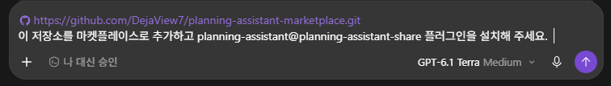

# 자비스 | 사업기획 통합 비서

자비스는 사업 아이디어, 공고문, 신청 양식과 고객 요청을 바탕으로 사업 방향을 검토하고 사업계획서·제안서의 초안을 작성하는 Codex 플러그인입니다.

**현재 버전: 0.2.8** · [설치하기](#설치하기) · [사용하기](#사용하기) · [팀 자료 공유](#팀에서-자료-공유하기) · [업데이트하기](#업데이트하기)

## 자비스가 돕는 업무

| 업무 | 활용 예시 |
| --- | --- |
| 사업 방향 검토 | 고객의 문제와 요구를 정리하고 가능한 대안을 비교합니다. |
| 공고·신청서 작성 | 공고 요건과 지정 양식을 확인해 항목별 초안을 작성합니다. |
| 고객 제안서 작성 | 고객 요구에 맞춰 수행 범위, 일정, 비용과 검수 조건을 정리합니다. |
| 기존 문서 보완 | 문장, 근거, 수치와 실행계획을 검토하고 초안을 수정합니다. |

IR 구성, 시장 조사, 가격·재무 검토도 요청할 수 있습니다. 확인된 사실과 제안·가정·미확인 사항을 구분하고, 부족한 근거와 필요한 확인 사항을 함께 정리합니다.

플러그인에는 전문 기능 7종, 전문가 관점 31종, 지침 68개가 포함됩니다. 전문가 관점은 AI가 활용하는 검토 기준입니다.

## 설치하기

현재 안내하는 설치 방법은 **Codex 마켓플레이스**를 이용합니다. Codex 앱과 로그인 계정이 필요하며, 이 플러그인의 지침을 사용하기 위해 별도로 Node.js를 설치할 필요는 없습니다. 설치·파일 처리에 필요한 환경은 사용하는 Codex와 컴퓨터에 따라 다를 수 있습니다.

1. Codex 앱을 열고 로그인한 뒤 새 대화를 시작합니다.
2. 아래 문구를 **Codex 대화 입력창**에 복사해 보냅니다.

```text
https://github.com/DejaView7/planning-assistant-marketplace.git
이 저장소를 마켓플레이스로 추가하고 planning-assistant@planning-assistant-share 플러그인을 설치해 주세요.
```



3. 설치가 완료되면 Codex를 다시 실행하고 새 대화를 시작합니다.
4. 다음과 같이 설치 상태를 확인합니다.

```text
planning-assistant 플러그인의 버전과 활성화 상태를 확인해 주세요.
```

설치 상태를 확인한 뒤에는 공개 공고나 가상 자료로 문서 작성까지 시험해 볼 수 있습니다. 저장소는 공개되어 있어 열람에 별도의 초대가 필요하지 않습니다.

### 설치가 잘되지 않을 때

| 상황 | 확인 방법 |
| --- | --- |
| 플러그인을 찾을 수 없습니다. | Codex에 “planning-assistant-share 마켓플레이스와 planning-assistant 플러그인의 등록·설치 상태를 확인해 주세요.”라고 요청합니다. |
| Git을 찾을 수 없다는 안내가 나옵니다. | Codex에 “이 컴퓨터에서 Git을 사용할 수 있는지 확인하고 설치 방법을 안내해 주세요.”라고 요청합니다. |
| 설치했는데 지침이 보이지 않습니다. | Codex를 다시 실행하고 새 대화에서 플러그인 활성화 상태를 확인합니다. |

## 사용하기

대화창에서 **자비스**와 함께 원하는 업무를 적어 주세요.

> 자비스, 이 사업 아이디어를 구체화하고 기획서 초안을 작성해 주세요.

> 자비스, 첨부한 공고와 신청 양식을 확인하고 항목별 초안을 작성해 주세요.

> 자비스, 고객의 요구를 기준으로 제안 방향을 비교하고 확인할 사항을 알려 주세요.

> 자비스, 이 초안의 근거와 수치를 검토하고 자연스러운 문장으로 수정해 주세요.

같은 대화에서는 “필요성 부분을 보강해 주세요”처럼 이어서 요청할 수 있습니다. 자비스가 선택되지 않으면 “planning-assistant 플러그인을 사용해 주세요”라고 명시합니다. 자비스는 대화용 이름입니다.

### 공고와 신청 양식

공고문과 신청서를 함께 제공하면 신청 자격, 기한, 평가 항목, 필수 서류와 작성란을 확인해 초안에 반영합니다. 확인 가능한 기업 기본정보는 근거와 기준일을 대조합니다. 확인되지 않은 정보는 임의로 채우지 않습니다.

양식 사본을 편집한 경우 저장된 결과를 다시 열어 입력 위치와 값을 확인합니다. 서약·동의 여부와 서명·날인은 담당자가 직접 확인합니다.

### HWP·HWPX·PDF 자료

한글 파일은 사용 가능한 도구로 본문과 표를 먼저 확인합니다. 읽기가 불완전하면 원본을 보존하고 가능한 환경에서 PDF 또는 DOCX 사본으로 변환해 다시 확인합니다. 스캔 PDF는 필요한 경우 OCR과 화면 확인을 병행합니다.

파일 읽기·변환·편집, 표 추출과 결과물의 화면 검토는 **사용 중인 앱과 도구의 지원 범위**에 따라 달라집니다. 확인하지 못한 내용과 검증 범위는 별도로 보고합니다.

## 팀에서 자료 공유하기

회사가 관리하는 **공용 Google Drive 또는 다른 공용 저장소**에 제품 소개서, 공고문, 증빙과 기존 결과물을 정리해 두면 팀원들이 최신 자료를 공유하기 편리합니다.

각 팀원은 본인 계정으로 연결하고, 접근 권한이 있는 자료를 사용합니다. AI 앱이 해당 저장소 연결을 지원해야 하며, 연결되지 않았거나 파일을 읽을 수 없다면 필요한 자료를 직접 제공할 수 있습니다.

자비스 플러그인 자체에는 회사 자료나 대화 기록이 들어 있지 않습니다. 자료 접근과 저장은 사용 중인 AI 앱과 연결 서비스의 기능·권한에 따릅니다. 중앙 MCP 서버는 필수로 요구하지 않습니다.

## 웹 ChatGPT에서 사용하기

현재 이 저장소에서 확인한 설치 방식은 Codex 마켓플레이스입니다. GitHub에 공개되어 있다는 이유만으로 웹 ChatGPT의 모든 계정에 자동 설치되지는 않습니다.

지원되는 회사 워크스페이스에서는 관리자가 GitHub 마켓플레이스를 가져오는 방식을 검토할 수 있습니다. **자비스의 웹 설치·실행과 개인 무료 계정 사용은 아직 실제 검증하지 않았습니다.** 확인 항목은 [웹 사용 검증 안내](docs/WEB_TEST.md)를 참고해 주세요.

## 업데이트하기

관리자가 GitHub의 플러그인 지침을 갱신한 뒤, Codex 대화창에 아래와 같이 요청합니다.

```text
planning-assistant-share 마켓플레이스를 최신 버전으로 업데이트하고
planning-assistant 플러그인의 버전과 반영 상태를 확인해 주세요.
```

업데이트 후 Codex를 다시 실행하고 새 대화에서 적용 상태를 확인합니다. 저장소의 개발용 검사만 변경된 경우에는 설치된 플러그인 지침이 바뀌지 않을 수 있습니다.

0.1.x 버전에서 업데이트한 뒤 이전 지침 조회 서버인 planning-guides MCP 연결 오류가 계속 나타나면, Codex에 해당 플러그인의 삭제와 planning-assistant-share 마켓플레이스에서의 재설치를 요청합니다. 0.2.0부터는 해당 서버가 필요하지 않습니다.

## 개발자 안내

저장소를 수정한 뒤에는 [업데이트 전 검사](docs/MAINTENANCE_CHECKS.md)와 [실제 문서 시험 기준](docs/REAL_DOCUMENT_TESTS.md)을 참고합니다. 개발용 검사는 글자·숫자 변경과 배포 구성을 점검하며, 모든 사실이나 문서 배치를 자동으로 보증하지 않습니다.

## 라이선스

직접 작성한 플러그인 구성과 통합 지침은 MIT 라이선스입니다. 사용자 제공 원본 자료의 권리 구분은 [THIRD_PARTY_NOTICES.md](THIRD_PARTY_NOTICES.md)를 참고해 주세요.
